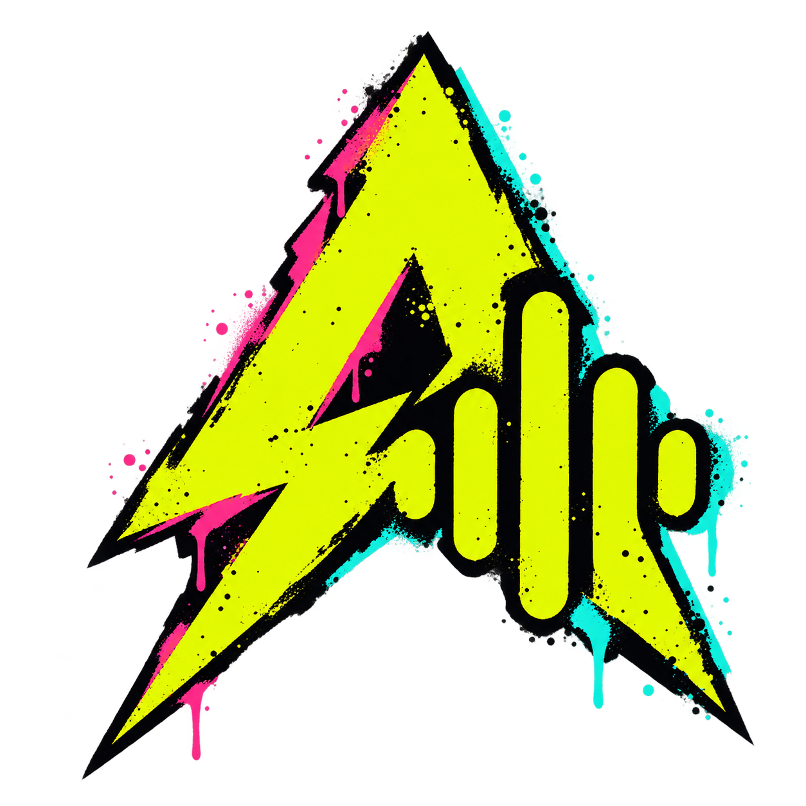

<div align="center">
  
  <h1>AFK — Away From Keyboard</h1>
  <p><strong>Speak. Transcribe. Get back to what matters.</strong></p>
  <p>Local dictation and meeting recording for Linux.</p>
  <p>
    <a href="https://github.com/dev-idkwhoami/away-from-keyboard/actions/workflows/package.yml"></a>
  </p>
</div>

AFK turns speech into text without sending your audio to a transcription service.
Press a shortcut, speak, and press it again to copy the result. A small floating
bubble keeps the transcript close without taking over your screen.

Built for Arch Linux and CachyOS, with English and German as the primary use cases.
**Early development:** the current desktop build targets NVIDIA GPUs and KDE Plasma.

## What you can do

- **Dictate anywhere.** Toggle recording with a configurable global shortcut.
  Your transcript goes to the clipboard when you stop.
- **Keep it small.** Use a frameless floating bubble with an animated recording
  indicator or expandable live text. Choose from nine screen positions.
- **Record meetings, process later.** Capture your microphone and meeting audio
  separately, then generate a transcript with speaker labels when you're ready.
- **Transcribe audio files.** Import common audio formats, with optional speaker
  labels, from Studio or the tray menu.
- **Choose your model.** Download, switch and remove local Whisper models.
  Add Nemotron for speaker labeling.
- **Find something you said.** Keep optional transcription history and copy a
  previous result again.
- **Make it yours.** Light, dark and system themes, with a neon punk look.

AFK stays in the system tray when you close a window. The bubble appears while
listening; closing it does not stop recording. Choose **Close** in the tray menu
to quit the app.

## Install

Download an Arch package from [Releases](https://github.com/dev-idkwhoami/away-from-keyboard/releases)
when a release is published. Development packages are available from successful
[Arch package builds](https://github.com/dev-idkwhoami/away-from-keyboard/actions/workflows/package.yml):
open a successful version-tag run, download `afk-arch-x86_64`,
and extract the artifact ZIP. Normal branch pushes do not trigger CI.

From the directory containing the downloaded package:

```sh
sudo pacman -U ./afk-0.2.0-1-x86_64.pkg.tar.zst
```

Use the filename for the version you downloaded. Launch **Away From Keyboard**
from your application menu, or run `afk-desktop`.

The package includes precompiled Whisper and Nemotron engines. Models download
separately inside the app. There is no AUR dependency and no compilation on first
launch. Arch's CUDA package is currently required and is a substantial additional
download if you don't already have it.

### Requirements

| | Current support |
|---|---|
| System | Up-to-date Arch Linux or CachyOS, x86_64 |
| GPU | NVIDIA Turing or newer, with a compatible NVIDIA driver and CUDA |
| CPU | AVX2, FMA, F16C and BMI2 support |
| Desktop | KDE Plasma for the built-in global shortcut; XWayland for bubble placement on Wayland |
| Audio | PulseAudio or PipeWire with PulseAudio compatibility |
| Network | Needed for model downloads; prepared models run offline |

## Your first transcription

1. Open **Model Garage** and download a Whisper model. Small Q5 has the smallest
   download; Turbo Q5 is another option to try.
2. In **Studio**, choose English, German or automatic language detection.
3. Set your preferred shortcut in **Settings**. The default is `Ctrl+Shift+Space`.
4. Press the shortcut, speak, then pause briefly after your last word.
5. Press it again and paste your transcript wherever you need it.

Live text is provisional and can change as you speak. Short or noisy phrases can
confuse automatic language detection; choosing English or German explicitly can help.

## Models

| Model | Download | English / German | Auto language |
|---|---:|:---:|:---:|
| Whisper Small · Q5 | 190 MB | ✓ | ✓ |
| Whisper Turbo · Q5 | 574 MB | ✓ | ✓ |
| Whisper Turbo · Q8 | 874 MB | ✓ | ✓ |
| Whisper Large V3 · Q5 | 1,081 MB | ✓ | ✓ |
| Nemotron 3 · Q8 | 107 MB | Speaker labels | — |

Download sizes are not GPU memory requirements. Model downloads are checksum-verified.
Nemotron adds generic speaker labels; it does not recognize people's identities.

## Meetings and files

Open **Meetings** to select your microphone and a desktop output or active
application audio stream. **Stop & save** adds the recording to meeting history.
Open a saved meeting to **Process recording**, read its transcript, or name its
speakers. Meeting transcripts stay on their own pages, separate from Studio and
dictation history. Recording itself does not run an AI model.

Use **Transcribe file** for existing audio. Both workflows keep processing local.
Speaker labels and timestamps are estimates, particularly when people talk over
each other. Use headphones when recording meetings to reduce duplicate audio from
speaker bleed.

See the [usage guide](docs/usage.md) for audio sources, recording storage, file
formats and current limits.

## Your data stays local

Dictation audio is processed in memory. Meeting recordings are saved locally so
you can process them later. Transcription history is optional; turning it off or
deleting a history entry **does not delete saved meeting audio**.

Installed builds store models, settings, history and recordings in
`~/.local/share/afk`, or `$XDG_DATA_HOME/afk` if configured. Use `--data` to choose
another location.

## Build and contribute

- [Development guide](docs/development.md) — build the app, use the CLI, run checks.
- [Packaging guide](packaging/README.md) — `make package`, dependencies and GitHub Actions.
- [Third-party components](THIRD_PARTY.md) — engines, models and dependency licenses.
- [Report an issue](https://github.com/dev-idkwhoami/away-from-keyboard/issues) — include your desktop, GPU and model, plus steps to reproduce.

AFK does not yet have a project-level open-source license. Third-party components
retain their respective licenses.
